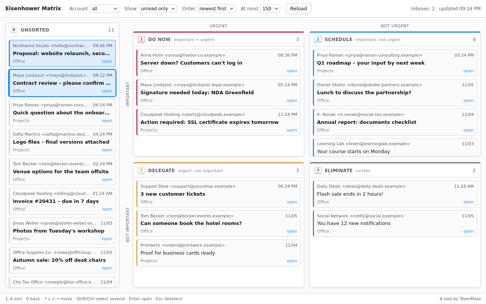

# Eisenhower Matrix for Thunderbird

Sort your inbox into the four Eisenhower quadrants: **Do now**, **Schedule**,
**Delegate**, **Eliminate**. Drag cards with the mouse or fly through with the
keyboard (`1`–`4`).

## Why tags

The add-on stores nothing of its own. Each decision becomes a regular
Thunderbird tag on the message, which is an IMAP keyword. That means:

- you see the quadrant in the normal message list, and can filter and sort by it
- it syncs to the server and shows up on every device
- it survives uninstalling the add-on
- your own tags stay untouched; only the four quadrant tags are swapped

No mail content leaves your computer. There is no server, no account, no tracking.

## Keyboard

| Key | Action |
|---|---|
| `1` `2` `3` `4` | move the selected mails into a quadrant |
| `0` | back to *Unsorted* |
| `↑` `↓` | move through a column (`Shift` extends the selection) |
| `←` `→` | jump to the previous / next column |
| `Shift`-click, `Ctrl`-click | select several, `Ctrl+A` selects a whole column |
| `Enter` / double-click | open the message |
| `Esc` | clear the selection |

## Install

From [addons.thunderbird.net](https://addons.thunderbird.net/) (search for
*Eisenhower Matrix*), or build it yourself:

    ./build.sh

and install `eisenhower-matrix-<version>.xpi` via
*Add-ons and Themes → gear icon → Install Add-on From File*.
Requires Thunderbird 140 or newer.

## Development

Everything runs on the official MailExtension API, without Experiment APIs, so
the add-on keeps working across Thunderbird updates.

| File | Purpose |
|---|---|
| `manifest.json` | permissions, entry points |
| `quadrants.js` | the four quadrants: tag keys and colours (keys must never change) |
| `background.js` | creates the tags and the space button in the left bar |
| `matrix.html/.css/.js` | the board |
| `_locales/` | English and German texts |
| `werkzeuge/` | demo with invented mailboxes, tests, screenshots (not shipped) |
| `katalog/` | listing texts and screenshots for addons.thunderbird.net |

Tests and screenshots run against a mock of the Thunderbird API in Firefox
(same engine as Thunderbird), using made-up mailboxes only:

    npm install
    npm test              # 31 checks: order, keyboard, multi-select, drag & drop, tags
    npm run screenshots   # katalog/screenshots/*.png

## Deutsch

Sortiert den Posteingang per Drag & Drop oder Tastatur in die vier
Eisenhower-Quadranten. Die Einordnung wird als normales Thunderbird-Schlagwort
gespeichert, per IMAP synchronisiert und überlebt die Deinstallation. Keine Mail
verlässt den Rechner. Oberfläche auf Deutsch und Englisch, je nach Sprache von
Thunderbird.

---

Made by [TeamMaid](https://team-maid.de/) · MIT License
